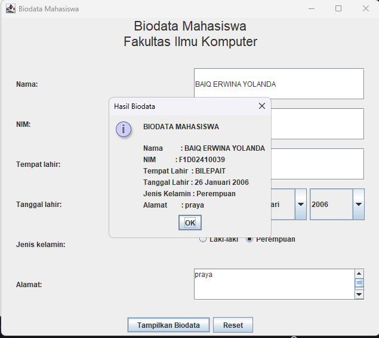

# BAIQ ERWINA YOLANDA

# F1D02410039

# Form Biodata Mahasiswa

Aplikasi **Form Biodata Mahasiswa** berbasis Java Swing. Program ini
merupakan latihan dasar GUI untuk menerima data mahasiswa melalui form,
memvalidasi kelengkapan data, menampilkan ringkasan biodata, dan
mengosongkan form melalui tombol Reset.

## 1. Fitur Aplikasi

- Mengisi nama mahasiswa.
- Mengisi NIM.
- Mengisi tempat lahir.
- Memilih tanggal, bulan, dan tahun lahir.
- Memilih jenis kelamin melalui radio button.
- Mengisi alamat pada area teks.
- Menampilkan ringkasan biodata melalui pop-up.
- Menampilkan peringatan jika masih ada data yang belum diisi.
- Mengosongkan seluruh isian menggunakan tombol Reset.

## 2. Teknologi dan Komponen

- **Bahasa pemrograman:** Java
- **Pustaka GUI:** Java Swing
- **Event handling:** `ActionListener`

Komponen Fungsi

---

`JFrame` Jendela utama aplikasi
`JPanel` Mengelompokkan komponen form
`JLabel` Menampilkan judul dan label input
`JTextField` Input nama, NIM, dan tempat lahir
`JComboBox` Memilih tanggal, bulan, dan tahun
`JRadioButton` Memilih jenis kelamin
`ButtonGroup` Membuat pilihan jenis kelamin saling eksklusif
`JTextArea` Input alamat beberapa baris
`JScrollPane` Menyediakan scrollbar untuk area alamat
`JButton` Tombol Tampilkan Biodata dan Reset
`JOptionPane` Menampilkan hasil biodata dan pesan validasi

## 3. Struktur Program

Program menggunakan satu class utama:

```text
FormBiodata.java
```

Class `FormBiodata` sekaligus menjadi jendela aplikasi, mengatur
komponen form, menangani event tombol, memvalidasi data, menampilkan
hasil, dan mereset isian.

Deklarasi class:

```java
public class FormBiodata extends JFrame implements ActionListener
```

- `extends JFrame`: menjadikan `FormBiodata` sebagai turunan `JFrame`,
  yaitu jendela utama aplikasi.
- `implements ActionListener`: memungkinkan class menangani aksi
  tombol melalui method `actionPerformed()`.

Program dijalankan melalui method `main()` yang menggunakan
`SwingUtilities.invokeLater()` untuk membuat dan menampilkan GUI pada
Event Dispatch Thread.

## 4. Penerapan Materi GUI

### A. Top-level Container Class

Aplikasi menggunakan `JFrame` sebagai jendela utama. Pengaturan jendela
dilakukan dengan `setTitle()`, `setSize()`,
`setDefaultCloseOperation()`, dan `setLocationRelativeTo()`.

### B. Intermediate Container Class

Program menggunakan beberapa `JPanel` untuk mengelompokkan komponen:

- `panelForm`: menampung label dan komponen isian biodata.
- `panelTanggal`: mengelompokkan pilihan tanggal lahir.
- `panelGender`: mengelompokkan pilihan jenis kelamin.
- `panelTombol`: menampung tombol Tampilkan Biodata dan Reset.

### C. Atomic Component Class

Komponen yang digunakan meliputi `JLabel`, `JTextField`, `JComboBox`,
`JRadioButton`, `JTextArea`, dan `JButton`. `JOptionPane` digunakan
untuk menampilkan dialog hasil dan validasi.

### D. Layout Classes

---

Layout Penerapan Fungsi

---

`BorderLayout` Pada `JFrame` Membagi jendela menjadi
bagian NORTH, CENTER,
dan SOUTH.

`GridLayout` Pada `panelForm` Menyusun label dan
input dalam enam baris
dan dua kolom.

`GridLayout` Pada `panelTanggal` Menyusun pilihan
tanggal, bulan, dan
tahun dalam satu baris
tiga kolom.

`FlowLayout` Pada `panelGender` dan Menyusun komponen
`panelTombol` secara berurutan dalam
satu baris.

---

### E. Event Listener dan Method Override

Class `FormBiodata` mengimplementasikan `ActionListener`. Kedua tombol
didaftarkan dengan:

```java
btnTampilkan.addActionListener(this);
btnReset.addActionListener(this);
```

Method `actionPerformed(ActionEvent e)` dioverride untuk memeriksa
tombol yang ditekan:

- Jika tombol Tampilkan Biodata ditekan, method `tampilkanBiodata()`
  dipanggil.
- Jika tombol Reset ditekan, method `resetForm()` dipanggil.

## 5. Alur Kerja Program

### Menampilkan biodata

1.  Pengguna mengisi seluruh kolom biodata.
2.  Pengguna memilih tanggal lahir dari tiga `JComboBox`.
3.  Pengguna memilih salah satu jenis kelamin.
4.  Pengguna menekan tombol **Tampilkan Biodata**.
5.  Program mengambil nilai dari setiap komponen.
6.  Program memeriksa apakah ada data yang belum diisi.
7.  Jika semua data lengkap, program menyusun ringkasan dan
    menampilkannya melalui `JOptionPane`.

### Validasi data

Program memeriksa nama, NIM, tempat lahir, alamat, jenis kelamin,
tanggal, bulan, dan tahun. Jika ada bagian yang kosong atau pilihan
tanggal masih pada nilai awal, aplikasi menampilkan pesan:

> Mohon lengkapi semua data!

### Reset form

Ketika tombol **Reset** ditekan: - Kolom nama, NIM, dan tempat lahir
dikosongkan. - Pilihan tanggal, bulan, dan tahun dikembalikan ke pilihan
awal. - Pilihan jenis kelamin dibatalkan. - Kolom alamat dikosongkan.

## 6. Dokumentasi Screenshot

### Tampilan awal form biodata

Berikut tampilan form untuk mengisi identitas mahasiswa.


### Peringatan data belum lengkap

Jika pengguna menekan tombol Tampilkan Biodata sebelum melengkapi
seluruh kolom, aplikasi menampilkan pesan validasi.


### Hasil biodata

Jika seluruh data telah diisi, aplikasi menampilkan ringkasan biodata
dalam dialog informasi.



## 7. Cara Menjalankan Aplikasi

1.  Pastikan Java Development Kit (JDK) telah terpasang.
2.  Buka `FormBiodata.java` melalui IDE Java seperti NetBeans, IntelliJ
    IDEA, atau Eclipse.
3.  Pastikan nama file sesuai dengan nama class `FormBiodata`.
4.  Jalankan class `FormBiodata` melalui method `main()`.

Jika menggunakan terminal, jalankan perintah berikut dari direktori
tempat file berada:

```bash
javac FormBiodata.java
java FormBiodata
```

## 8. Kesimpulan

Form Biodata Mahasiswa merupakan latihan GUI dasar menggunakan Java
Swing. Program menerapkan `JFrame` sebagai top-level container, `JPanel`
sebagai intermediate container, berbagai atomic component untuk input
dan interaksi, serta `BorderLayout`, `GridLayout`, dan `FlowLayout`
sebagai layout manager. Interaksi tombol ditangani melalui
`ActionListener` dengan override method `actionPerformed()`.

Aplikasi ini memperlihatkan proses dasar pengisian form, validasi data,
penampilan hasil melalui dialog, dan reset komponen GUI.
